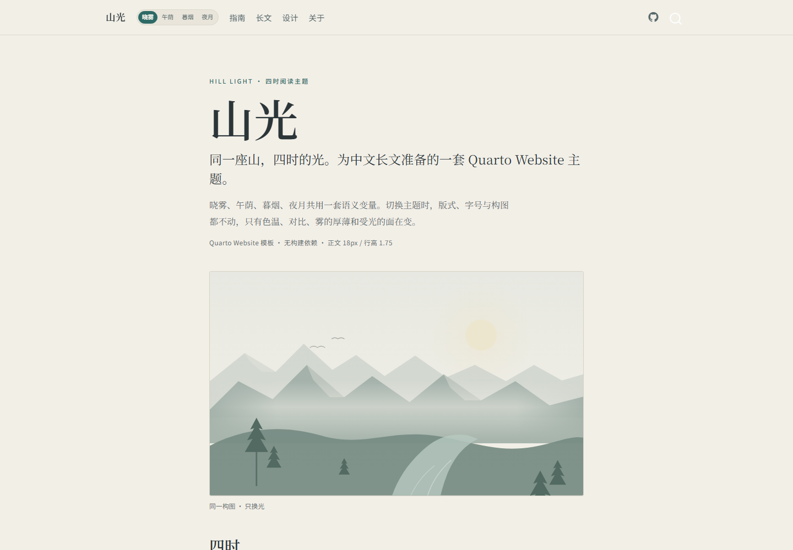
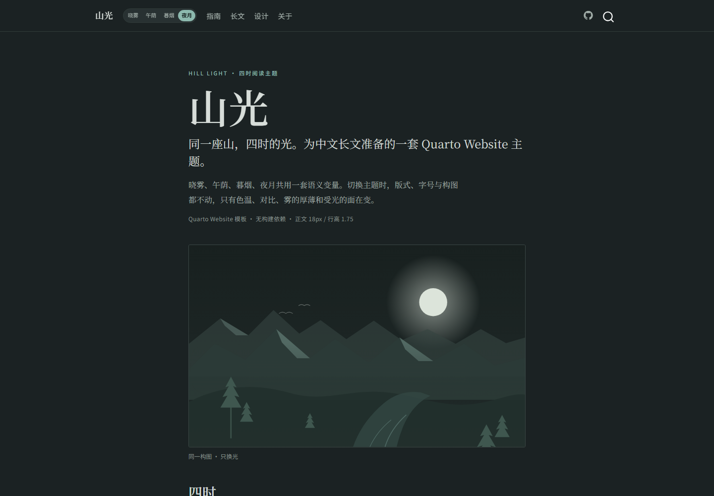
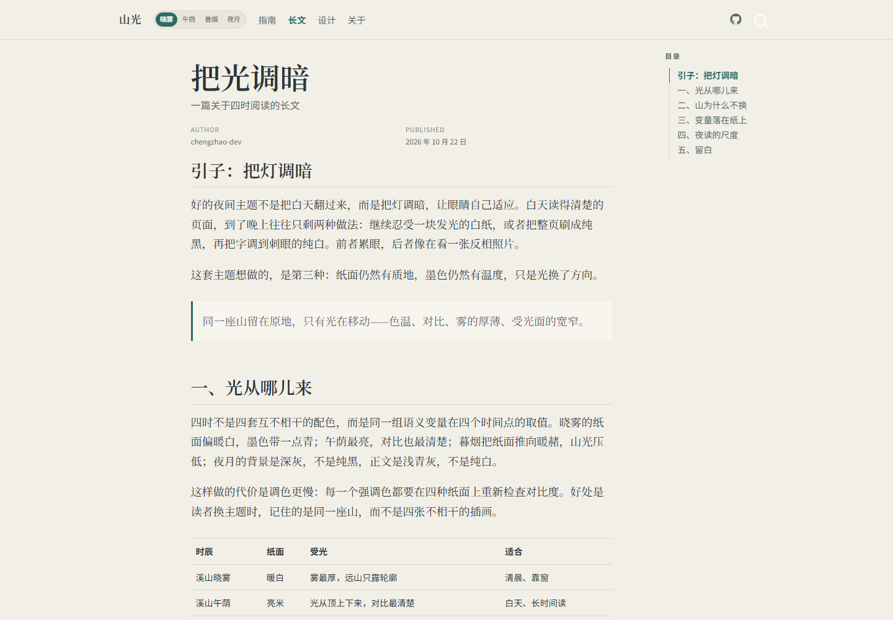
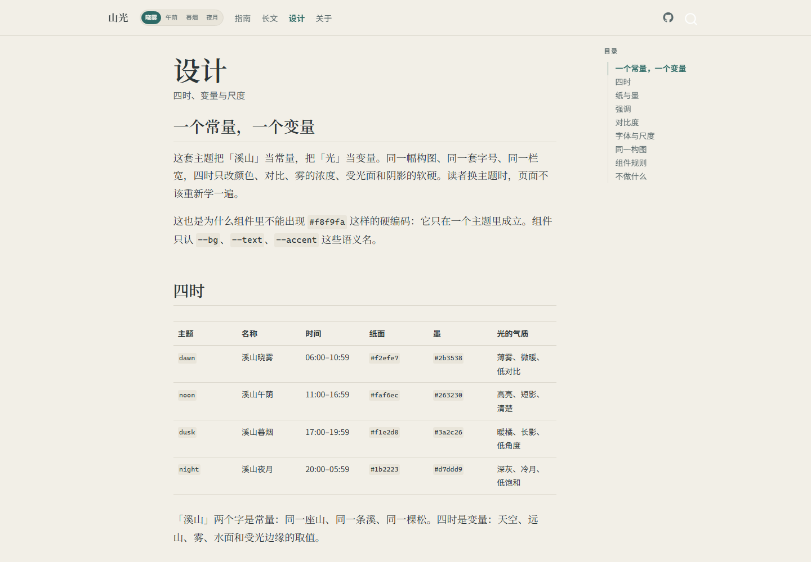
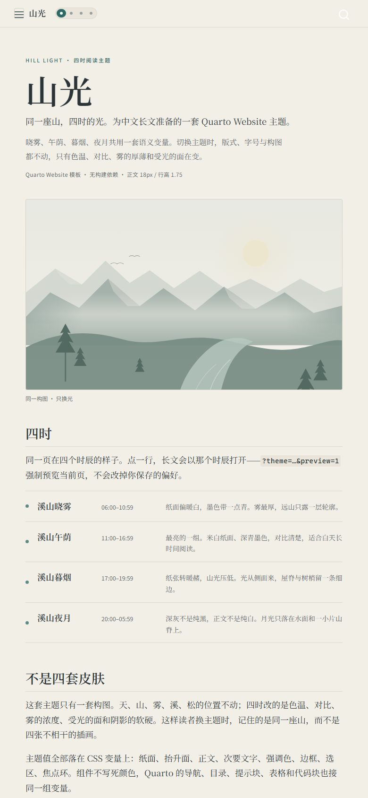

# 山光 / Hill Light · Quarto Website

一套为中文长文准备的四时阅读主题。同一座山，四时的光；版式、字号与构图不变，只有纸面、墨色、雾和受光面在变。

[在线预览](https://hill-light.github.io/hill-light-quarto-website/) · [Quarto Book 模板](https://github.com/hill-light/hill-light-quarto-book) · [核心规范](https://github.com/hill-light/hill-light-theme)



## 四时

| Key | 名称 | 本地时间 | 纸面 | 墨 | 强调 |
| --- | --- | --- | --- | --- | --- |
| `dawn` | 溪山晓雾 | 06:00–10:59 | `#f2efe7` | `#2b3538` | `#2d6a66` |
| `noon` | 溪山午荫 | 11:00–16:59 | `#faf6ec` | `#263230` | `#1d6a55` |
| `dusk` | 溪山暮烟 | 17:00–19:59 | `#f1e2d0` | `#3a2c26` | `#35645d` |
| `night` | 溪山夜月 | 20:00–05:59 | `#1b2223` | `#d7ddd9` | `#8cb9ae` |

夜月的背景不是纯黑，正文不是纯白。四个主题的正文对比度、链接、焦点环均按 WCAG AA 检查；最低值是夜月微文字在抬升面上的 4.54。

## 特点

- Quarto 扩展，不修改页面结构；导航、目录、搜索、提示块、表格、代码块全部接同一组 CSS 变量。
- 跟随本地时间自动切换；手动选择后记住偏好；`?theme=…&preview=1` 强制预览当前页，不写回偏好。
- 无构建依赖，没有 npm、PostCSS 或额外字体；扩展目录只有四个文件。
- 同一套山水 SVG 随主题变色，不是四张插画。
- 移动端顶栏保留四时切换，宽度不足 360px 时自动退成圆点。
- 支持 `prefers-reduced-motion`；系统要求减少动效时，颜色过渡为 0ms。

## 安装

要求 [Quarto](https://quarto.org/) 1.4 或更高。开发和验证使用 1.10.19。

### 1. 复制扩展

把本仓库的 `_extensions/hill-light/` 复制到你的网站根目录：

```bash
cp -r _extensions/hill-light /path/to/your-site/_extensions/
```

### 2. 启用格式

在 `_quarto.yml` 里使用扩展生成的格式名：

```yaml
format:
  hill-light-html: default
```

`hill-light-html` 是扩展名 `hill-light` 加 `-html`。不要写成 `theme: [hill-light]`，Quarto 不会把主题名解析成扩展。

### 3. 预览

```bash
quarto preview
```

## 主题如何选择

页面加载时会依次检查：

1. `?theme=dawn|noon|dusk|night&preview=1`：强制预览当前页；
2. `localStorage` 里的 `hill-light-theme`，用户上次手动选择；
3. 不带 `preview=1` 的 `?theme=…`：仅在还没有保存偏好时生效；
4. 本地时间：06:00–10:59 晓雾，11:00–16:59 午荫，17:00–19:59 暮烟，其余夜月。

带 `preview=1` 的 URL 能覆盖已保存偏好，保证文档里的「用某个时辰看看这一页」入口始终有效；它只影响当前页，不写回 `localStorage`。手动点击切换器会持久化，并清除 URL 里的 `theme` 与 `preview` 参数。

## 页面

| 页面 | 用途 |
| --- | --- |
| `index.qmd` | 主题首页：主旨、同一幅山水、四时入口 |
| `guide.qmd` | 安装、主题行为、变量表、覆盖方式、无障碍与边界 |
| `demo.qmd` | 800–1200 字长文，含目录、引用、表格、提示块、脚注 |
| `design.qmd` | 色板、对比度、字体尺度、组件规则 |
| `about.qmd` | 项目说明、仓库链接、许可 |

## 结构

```text
.
├── _extensions/hill-light/
│   ├── _extension.yml          # format 声明
│   ├── hill-light.scss         # 四时变量 + Quarto 组件覆盖
│   ├── hill-light-head.html    # 首屏防闪烁脚本
│   └── hill-light-body.html    # 切换器、持久化、30 分钟自动切换
├── _quarto.yml
├── index.qmd
├── guide.qmd
├── demo.qmd
├── design.qmd
├── about.qmd
└── docs/screenshots/
```

## 定制

覆盖变量优先于改扩展文件。在项目根目录建 `custom.css` 或 `custom.scss`，在 `format.hill-light-html` 下追加：

```yaml
format:
  hill-light-html:
    css: custom.css
```

最常改的是纸面、强调色和阅读栏宽：

```css
:root,
[data-theme="dawn"] {
  --bg: #f2efe7;
  --accent: #2d6a66;
  --measure: 680px;
}
```

四时都要改时，分别写 `[data-theme="noon"]`、`[data-theme="dusk"]`、`[data-theme="night"]`。只改一个主题会导致切换后仍显示旧色。

## 开发

```bash
quarto render
quarto preview
```

输出在 `_site/`。扩展的 SCSS 由 Quarto 编译进 Bootstrap bundle；改完 `hill-light.scss` 需要重新 render，浏览器热更新不会重新编译它。

## 截图

| 晓雾 | 夜月 |
| --- | --- |
|  |  |

| 长文 | 设计 |
| --- | --- |
|  |  |

移动端：

## 兄弟仓库

- [hill-light-theme](https://github.com/hill-light/hill-light-theme)：核心规范、CSS 变量、静态演示站与对比度检查。
- [hill-light-quarto-book](https://github.com/hill-light/hill-light-quarto-book)：Quarto Book 版本，带侧栏、章节导航与页导航。
- 本仓库：Quarto Website 版本与模板。

三个仓库共享同一套语义变量。改色值时先改核心仓库的 `css/tokens.css` 和 `DESIGN.md`，再同步到两个扩展，避免下游各自漂移。

## 许可

MIT。见 [LICENSE](LICENSE)。中文字体不随仓库分发，正文回退到系统自带的宋体或 Noto Serif SC。
